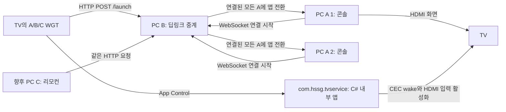

# S2S Launch Test

TV에서 A/B/C게임 WGT를 실행하면 PC B가 명령을 받아 **연결된 모든 PC A의 게임 화면을 전환**하는 인트라넷 데모다. PC A는 Xbox 같은 콘솔 역할, PC B는 게임사의 딥링크 중계 서버 역할이다. 기존 프로젝트와 독립적으로 관리한다.

**관리할 서버 주소는 PC B 주소 하나다.** PC A들은 B에 먼저 WebSocket으로 연결하고, TV와 향후 리모컨 역할의 PC C는 B에 HTTP 명령을 보낸다. A의 IP를 등록하지 않는다.



WGT는 HTTP와 App Control을 각각 시작한 뒤 양쪽 호출 콜백이 끝나면 스스로 종료한다. 내부 서비스에 HDMI 포트나 게임 정보를 전달하지 않는다. C# 서비스 구현 담당자는 [TV 서비스 구현 명세](docs/tv-service.md)를 기준으로 작업한다.

## 가장 빠른 실행: 한 PC에서 A + B

Node.js 22 이상을 설치한 뒤 프로젝트 폴더에서 실행한다.

```sh
npm ci
npm run dev
```

터미널에 열어야 할 주소와 순서가 표시된다.

1. 콘솔 화면 `http://localhost:4101`을 먼저 연다.
2. 다른 탭에서 `http://localhost:4100/tv/game-a/`를 열면 콘솔이 A게임으로 바뀐다. `game-b/`, `game-c/`도 같다.
3. 콘솔에서 방향키와 Enter로 직접 게임을 실행하고 Esc로 홈에 돌아온다. 전체화면은 F11 또는 화면의 버튼을 사용한다.

이 모드는 A가 B에 루프백으로 자동 연결하므로 IP를 입력하지 않는다. 브라우저 미리보기는 Tizen API가 없어 HDMI를 제어하지 않는다.

## Windows에서 개별 실행

| 실행할 프로그램 | 시작 파일 | 주소 입력 | 브라우저에서 할 일 |
|---|---|---|---|
| PC B | `start-pc-b.cmd` | 이 PC의 LAN IP. 같은 PC에서만 테스트하면 `127.0.0.1` | 실행 창의 게임 미리보기 주소로 명령 전송 가능 |
| PC A | `start-pc-a.cmd` | 연결할 **PC B의 IP** | 실행 창에 표시된 `http://localhost:4101`을 이 A에서 열기 |

두 시작 파일은 필요한 npm 의존성을 처음에 설치한다. 입력한 B 주소는 Git에서 제외된 `config.local.json`에 저장하며 다음 실행 때 Enter로 재사용한다. A 주소를 B에 등록하는 단계는 없다. B는 입력한 주소를 넣어 WGT도 생성한다. 실제 TV 설치에는 서명이 필요하다.

같은 PC에서 A와 B를 개별 실행해도 된다. 둘 다 B 주소에 `127.0.0.1`을 넣으며 서로 다른 포트 `4101`, `4100`을 사용한다. 다른 PC와 TV까지 연결할 때는 B의 LAN IP를 사용한다. 상세한 방화벽 설정과 WGT 설치 방법은 [실행 가이드](docs/setup.md)에 있다.

## 앱 목록

| 게임 | WGT application ID | PC A 데모 |
|---|---|---|
| A게임 | `R7kP2mN9vQ.ApexRacing` | ApexRacing |
| B게임 | `F3bT8xL4cW.ForestQuest` | ForestQuest |
| C게임 | `O6nH1sD5aZ.OrbitArena` | OrbitArena |

게임과 식별자는 데모용 가상 값이다. 별도 게임 실행 파일 대신 브라우저 화면을 전환한다. 로컬 조작은 해당 A만 변경하고, B로 보낸 요청은 그때 연결된 모든 A를 변경한다. 끊겨 있던 A에 과거 명령을 재생하지 않는다.

## 문서

- [문서 안내](docs/README.md)
- [전체 흐름도와 통신 방식](docs/flow.md)
- [실행과 설정, WGT 서명 및 설치](docs/setup.md)
- [PC A 콘솔 화면과 키보드 조작](docs/console.md)
- [HTTP와 WebSocket 인터페이스](docs/api.md)
- [A게임 요구사항](docs/app-a.md), [B게임 요구사항](docs/app-b.md), [C게임 요구사항](docs/app-c.md)
- [com.hssg.tvservice C# 앱 구현 명세](docs/tv-service.md)

## 소스 구조

```text
src/server.mjs       A/B HTTP 서버, 콘솔 상태, 로컬 화면 전달
src/console-link.mjs A가 시작하는 WebSocket 연결, B의 전체 전송과 결과 집계
src/config.mjs       공통 설정과 게임 목록
src/startup.mjs      실행 시 B 주소 입력과 로컬 저장
src/guide.mjs        역할별 실행 안내
web/                PC A 콘솔 홈과 게임 화면
tv/                세 WGT의 공통 HTTP/App Control/종료 코드
scripts/            WGT 생성과 한 PC 데모 실행
tests/             명령 전달, 재연결, 여러 A, WGT 호출 및 종료 검증
docs/              요구사항과 구현/운영 문서
config.json         공유 기본값
config.local.json   각 PC의 설정 (Git 제외)
build/tv/           생성된 WGT 소스 (Git 제외)
dist/unsigned/      서명 전 WGT 세 개 (Git 제외)
```

```sh
npm test
npm run build:tv
```

서버 통신과 WGT 콜백 흐름은 자동 테스트로 확인한다. 실제 Windows 네트워크, TV의 WGT 실행과 종료, C# 내부 서비스, HDMI/CEC 동작은 실기기 검증이 필요하다. 기본 서버는 인증 없는 사설망 데모다.

공개 저장소: [Readiz/s2s-launch-test](https://github.com/Readiz/s2s-launch-test)
