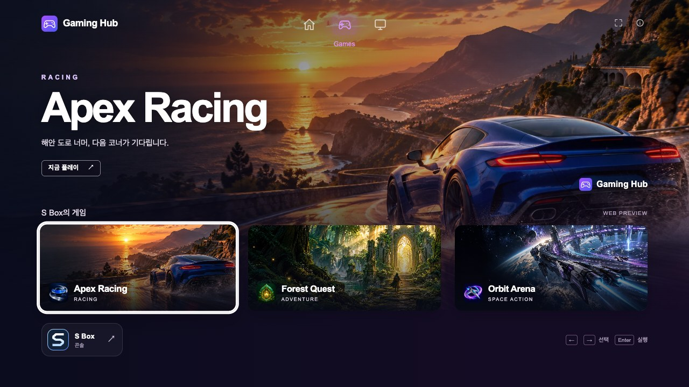
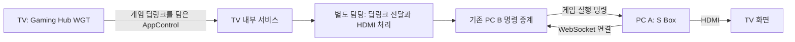

# Gaming Hub와 S Box

TV 런처 **Gaming Hub**와 PC 콘솔 **S Box**를 재현하는 독립 데모다. Gaming Hub에서 S Box에 연결된 세 게임을 선택하고, S Box는 명령을 받아 해당 게임 화면을 표시한다. S Box 자체 홈에서도 직접 게임을 실행할 수 있다.

| 앱 | 웹 검토 | 로컬 실행 |
|---|---|---|
| Gaming Hub | <https://gaminghub.dev.readiz.com> | TV용 `gaming-hub.wgt` |
| S Box | <https://sbox.dev.readiz.com> | PC에서 Node 서버와 브라우저 실행 |



기존 Apex Racing, Forest Quest, Orbit Arena 자산을 사용한다.

## 웹으로 두 화면 검토

Gaming Hub에서 **S Box** 버튼을 누르거나 게임을 선택하면 연결된 콘솔 탭이 열린다. 방향키로 게임을 고르고 Enter로 실행하면 그 탭의 S Box가 모의 로딩 후 해당 게임 타이틀로 바뀐다. 팝업 차단 시 이 사이트의 팝업을 허용한다. S Box의 Esc 또는 게임 종료로 콘솔 홈에 돌아온다.

웹 미리보기는 Hub가 연 S Box 탭과만 명령을 교환한다. 다른 방문자, 다른 Hub가 연 창과 직접 연 S Box 탭에는 요청을 전달하지 않는다. 서버에 공유 콘솔 상태를 저장하지 않으며 실제 TV 서비스나 HDMI를 제어하지 않는다.

## TV와 PC 연결



WGT는 내부 서비스에 AppControl만 보낸다. PC B HTTP나 기존 게임별 WGT를 추가 호출하지 않는다. 내부 서비스 이후의 구현은 다른 담당자가 맡으며 [서비스 인계 규격](docs/tv-service.md)에 정확한 송신값을 기록한다. AppControl 호출 접수와 실제 게임/HDMI 완료는 구분한다.

## 로컬 PC 데모

Node.js 24 LTS(24.22.1 이상)에서 실행한다.

```sh
npm ci
npm run dev
```

1. S Box 콘솔 <http://localhost:4101>을 먼저 연다.
2. Gaming Hub <http://localhost:4100>에서 게임을 고른다.
3. S Box가 실행 명령을 받아 해당 게임 타이틀로 바뀌는지 확인한다.

이 로컬 브라우저 데모는 Hub의 AppControl 이후 전달을 PC B의 기존 `POST /launch`로 모의한다. 실제 WGT에서는 이 HTTP 경로를 호출하지 않는다. PC를 나누면 `start-pc-b.cmd`와 `start-pc-a.cmd`를 사용한다. PC A는 저장한 PC B 주소에 자동 재연결하며, 게임 목록과 로컬 조작은 B가 없어도 사용할 수 있다.

## WGT 빌드와 서명

```sh
npm run build:tv
```

- 단일 서명 전 패키지: `dist/unsigned/gaming-hub.wgt`
- 서명할 소스: `build/tv/gaming-hub/`
- Hub application ID: `G7mH2uB8xQ.GamingHub`

Tizen 인증서 프로파일로 서명한 뒤 대상 TV에 설치한다.

```sh
tizen package -t wgt -s PROFILE_NAME -- build/tv/gaming-hub
```

Windows에서는 `build-wgt.cmd PROFILE_NAME`으로 빌드와 서명을 실행할 수 있다. 게임별 WGT 세 개는 더 이상 생성하지 않는다. 기존 게임 ID는 딥링크 대상 식별자로 유지한다. 서명키와 개인 설정은 Git과 웹 미리보기에 포함하지 않는다.

## 문서와 검사

- [제품 요구사항과 구현 상태](docs/gaming-hub.md)
- [설치와 실행](docs/setup.md)
- [TV 서비스 인계 규격](docs/tv-service.md)
- [실행 흐름](docs/flow.md), [PC 명령 인터페이스](docs/api.md)
- [S Box 화면과 키보드](docs/console.md)
- [두 개발 서버의 배포와 검증](docs/preview.md)

```sh
npm test
npm run build:preview
npm run build:tv
```

`hub/`는 TV 런처, `web/`는 PC 콘솔, `src/`는 기존 A/B 통신을 구현한다. `dist/gaminghub/`와 `dist/preview/`는 각각 공개 가능한 정적 UI만 내보낸다. 실제 TV 설치와 내부 서비스 수신, HDMI/CEC는 실기기에서 별도로 확인한다.
