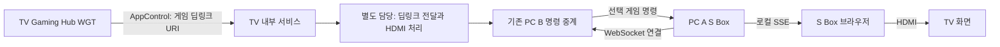
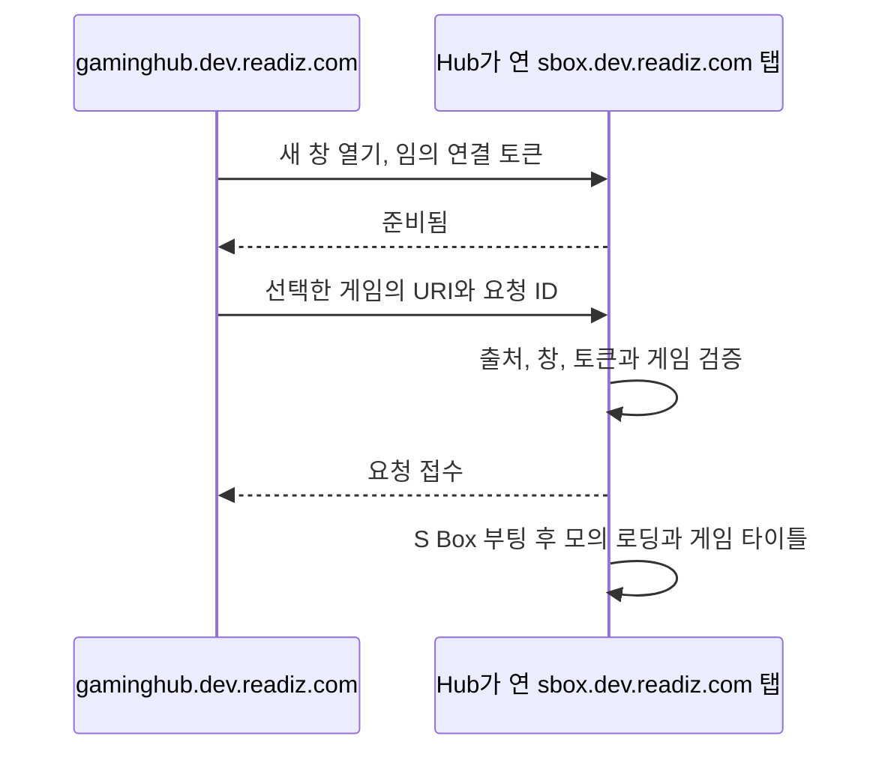

# 두 앱의 실행 흐름

## 실제 TV와 PC

Hub는 선택한 게임을 `sbox://launch?app=게임ID` URI로 내부 서비스에 전달한다. Hub에서 PC B HTTP를 함께 호출하지 않는다. 위 서비스 이후의 경로는 별도 담당자가 구현한다. PC B는 기존대로 명령 당시 연결된 모든 A에 전달한다.

AppControl 접수, PC 명령 전달과 실제 화면/HDMI 완료는 각각 다른 단계다. Hub는 접수 뒤 자동 종료하지 않으며 Back으로 종료할 수 있다.

## 공개 웹 미리보기

Hub가 연 창과만 `postMessage`를 교환한다. 서버 공유 상태, 공개 WebSocket이나 원격 명령 API를 만들지 않는다. 각 방문자와 창 쌍은 독립적이다. 같은 요청 ID는 중복 적용하지 않는다. 접수 응답은 게임 로딩과 렌더링 완료 응답이 아니다.

## 로컬 브라우저 데모와 PC 명령

`npm run dev`의 Hub는 PC B HTTP를 사용해 AppControl 이후 전달을 모의한다. S Box는 기존대로 B에 WebSocket 연결을 시작하고 로컬 브라우저에 SSE를 보낸다. 실제 WGT의 AppControl과 이 브라우저 경로를 혼동하지 않는다.

B의 재시작 뒤 A가 재연결한다. 끊긴 동안의 명령은 저장하거나 재생하지 않는다. A 자체 홈의 키보드 조작은 해당 A만 변경한다. 로딩 중 새 명령은 이전 타이머를 취소하고 마지막 게임을 표시한다.

[Hub 요구사항](gaming-hub.md) | [PC API](api.md) | [서비스 인계](tv-service.md)
