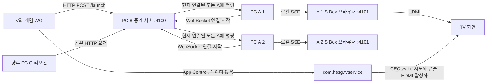
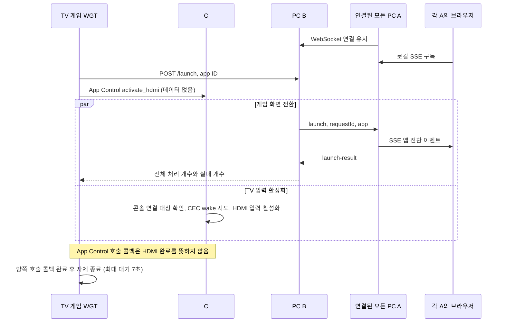

# 전체 흐름도

## 연결 구조

PC A가 B의 `/console`에 지속적인 WebSocket 연결을 만든다. B는 그 연결로 명령을 보낸다. 따라서 A의 IP나 수신 포트를 B에 등록하지 않는다. A의 HTTP 서버는 `127.0.0.1`에만 열고 브라우저는 같은 PC에서 접속한다.

S Box 페이지는 약 2.4초의 부팅 화면을 표시하며 그동안에도 로컬 SSE를 구독한다. 부팅 후에는 가장 마지막 앱 상태에 맞춰 홈 또는 게임 로딩 화면을 연다. 부팅과 게임 로딩은 시각 효과이며 서버의 명령 처리 응답을 지연시키지 않는다.

PC B에는 사설망에서 접근할 IP 하나가 필요하다. TV와 PC C는 그 주소로 HTTP 요청을 보내고, 모든 A도 같은 B 주소를 입력한다. A와 B를 같은 PC에 실행할 때는 B 주소에 `127.0.0.1`을 넣는다. B의 실제 수신 포트 기본값은 `4100`, A 브라우저의 로컬 포트는 `4101`이다.

## WGT 실행

HTTP와 App Control은 독립적으로 시작한다. 어느 한쪽 실패가 다른 쪽 실행을 막지 않는다. WGT는 서비스의 완료 reply를 기다리지 않는다. 내부 서비스는 WGT가 종료되어도 HDMI 작업을 계속해야 한다.

## 여러 콘솔과 연결 복구

- B는 HTTP 요청을 받은 시점의 연결 목록에 같은 명령을 보낸다. 이후 접속한 A는 이전 명령을 받지 않는다.
- A의 성공 응답은 로컬 브라우저 연결에 전환 이벤트를 썼다는 뜻이다. 화면 렌더링이나 HDMI 완료 확인이 아니다.
- 일부 A가 실패해도 다른 A에는 계속 전달한다. HTTP 응답으로 성공/실패 개수를 확인한다.
- B가 재시작되면 A가 자동 재연결한다. 재연결 후에는 새 요청부터 받으며 과거 요청을 재전송하지 않는다.
- 같은 B에 연결된 A들은 원격 요청 시 같은 게임으로 바뀐다. A의 키보드 조작과 홈 복귀는 해당 A만 바꾼다.

세부 시간 제한과 메시지는 [통신 인터페이스](api.md)에 정리되어 있다.

## 향후 PC C

PC C는 `POST http://B주소:4100/launch`에 게임 ID만 보내면 된다. B가 모든 A에 같은 명령을 전달하므로 C는 A 주소나 연결 목록을 관리하지 않는다. 현재 구현 범위는 이 인터페이스까지이며 별도의 C 리모컨 UI는 포함하지 않는다.

[실행 가이드](setup.md) | [콘솔 요구사항](console.md) | [C# 서비스 명세](tv-service.md) | [문서 안내](README.md)
