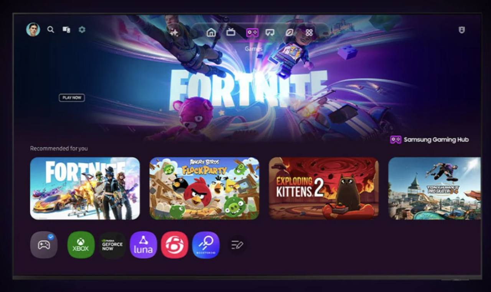

# Gaming Hub와 S Box 요구사항

2026-10-27 요구사항 변경. 앱은 TV용 **Gaming Hub**와 PC 콘솔용 **S Box** 두 개다. TV의 Gaming Hub는 WGT로 로컬 실행하며, S Box는 PC의 기존 명령 수신 역할을 유지한다. 기존 게임별 WGT 세 개는 단일 Hub WGT로 대체한다.

## 제품과 화면

Gaming Hub는 S Box에 연결된 개별 게임을 노출하는 TV 런처다. S Box 자체 홈도 계속 직접 사용할 수 있다. Hub에서 선택한 게임의 딥링크는 AppControl로 내부 서비스에 전달하고, 그 아래의 딥링크 전달과 콘솔 연결, HDMI 처리는 다른 구현 담당자가 맡는다.

첨부의 어두운 TV 화면, 상단 아이콘 탐색, 넓은 게임 배너와 가로 게임 카드, 하단의 콘솔 아이콘 구성을 따른다. 게임 배경과 아이콘은 기존 S Box 자산을 재사용한다. 큰 추천 이미지 아래에 세 게임의 설치 아이콘과 S Box 아이콘을 가로 런처로 표시한다. 첫 포커스는 첫 게임 아이콘이며, 게임 아이콘의 선택은 위 배너와 추천 이미지에 반영한다. 화면은 1920×1080 논리 해상도에 고정하고 배너, 16:9 추천 카드와 아이콘 간격을 참고 화면 비율에 맞춘다. FHD 화면에서 상하 48px씩 여백을 두고 전체 화면을 균일하게 축소해 중앙에 표시한다. 다른 화면 크기에서도 영역을 재배치하지 않고 같은 비율을 유지해 남는 공간을 여백으로 둔다. 선택한 게임이 배너에 반영되며 흰색 테두리와 크기 변화로 포커스를 구분한다. 도움말은 작은 아이콘 안에 둔다.

| 게임 | 딥링크의 app 식별자 |
|---|---|
| Apex Racing | `R7kP2mN9vQ.ApexRacing` |
| Forest Quest | `F3bT8xL4cW.ForestQuest` |
| Orbit Arena | `O6nH1sD5aZ.OrbitArena` |

이 ID는 선택한 게임을 나타낸다. Hub 자체 ID는 `G7mH2uB8xQ.GamingHub`, package ID는 `G7mH2uB8xQ`다.

## 조작과 호출

- 방향키로 게임을 선택하고 Enter 또는 리모컨 확인 키, 클릭으로 실행한다. 포커스 이동만으로 호출하지 않는다.
- 호출 중 연속 입력은 중복 송신하지 않는다. 실패와 7초 시간 초과를 표시하고 사용자가 다시 실행할 수 있다. 자동 재전송은 하지 않는다.
- 위/아래 방향키로 상단 탐색, 플레이 버튼, 추천 이미지와 하단 아이콘 런처를 오간다. 아이콘 줄에는 세 게임과 S Box가 함께 있으며 좌우로 순환한다. 숫자 키코드만 오거나 key가 Unidentified인 리모컨도 방향키 37~40, 확인 13, Return 10009로 조작한다. 길게 누른 확인 키는 반복 실행하지 않는다.
- Back/Return은 안내창을 먼저 닫는다. WGT의 기본 화면에서는 Hub를 종료하고 웹에서는 실행 안내를 닫거나 게임 선택으로 돌아온다.
- 호출 성공 뒤 Hub를 자동 종료하지 않는다. 내부 서비스의 입력/포그라운드 전환을 따르며, 사용자가 Hub로 돌아오면 선택 상태가 남는다. 서비스 처리와 독립된 `SINGLE` 실행을 요청한다.

## 실행 방식 세 가지

| 방식 | Hub의 송신 | S Box 동작 |
|---|---|---|
| 실제 TV WGT | 내부 서비스에 AppControl. `sbox://launch?app=게임ID` URI | 서비스 담당자가 기존 PC 명령 경로에 연결 |
| 공개 웹 검토 | Hub가 연 S Box 창으로 동일한 URI를 `postMessage`로 전달 | 해당 창에서 게임 전환 모의. 연결한 창 쌍만 공유 |
| 로컬 PC 데모 | 브라우저 Hub가 기존 PC B의 `POST /launch`를 호출해 하위 전달을 모의 | PC A가 WebSocket/SSE로 기존 명령을 받아 화면 전환 |

웹 검토 주소는 <https://gaminghub.dev.readiz.com>, <https://sbox.dev.readiz.com>이다. S Box를 직접 열면 자체 홈을 사용할 수 있다. Hub의 S Box 버튼이나 게임 실행으로 연 탭만 그 Hub와 연결한다. 정확한 출처와 창 참조, 임의 연결 토큰을 검증하고, 같은 요청 ID는 한 번만 적용한다. 서버 공유 상태나 다른 방문자에게 전달하는 공개 명령 API는 두지 않는다.

## AppControl과 산출물

현재 송신 계약은 [TV 서비스 인계](tv-service.md)에 정리했다. 이 저장소에서 정한 operation과 URI 규격이며 Samsung 내부 서비스가 이미 지원한다고 가정하지 않는다. 서비스 담당자가 새 Hub 호출자와 URI를 수신하도록 연결해야 한다.

`npm run build:tv`는 `dist/unsigned/gaming-hub.wgt` 한 개를 만들며 모든 게임 이미지와 아이콘을 포함한다. WGT는 내부 서비스 호출 권한만 선언하고 HTTP나 외부 그림 다운로드에 의존하지 않는다. 빌드가 만든 기존 `game-a/b/c` WGT와 생성 소스는 제거한다. 서명 전 파일 생성과 인증서 서명, 실제 TV 설치는 별도 단계다.

## 수용 조건과 구현 상태

| 항목 | 수용 조건 | 상태 |
|---|---|---|
| Hub 화면 | 참고 배치, 세 게임과 선택 배너, S Box 맥락 | 구현 완료 |
| TV 입력 | 방향키와 확인, Back, 중복 입력 차단 | 구현, 모의 API 및 브라우저 검증 |
| 단일 WGT | 고유 Hub ID와 아이콘, 로컬 자산 포함, 기존 세 패키지 대체 | 생성 및 ZIP/CRC/manifest 검사 |
| AppControl | 세 게임 URI와 한 서비스 대상, 실패/시간 초과/재시도 | 모의 API 검사. 실제 서비스 수신은 별도 |
| PC S Box | 기존 HTTP/WebSocket/SSE 명령 수신과 재연결, 자체 홈 사용 | 기존 경로 유지, 통합 검사 |
| 두 웹 앱 | 각 도메인 검토와 연결한 창 사이 게임 전환, 방문자 간 독립 | 브라우저 검증과 배포 결과는 [운영 기록](preview.md) |
| 하위 서비스 | 딥링크 전달과 콘솔 대상 결정, HDMI/CEC | 다른 담당자 구현 범위 |
| 실제 TV | 서명, 설치, 서비스 수신과 HDMI 확인 | 미검증 |

[실행 안내](setup.md) | [전체 흐름](flow.md) | [문서 안내](README.md)
