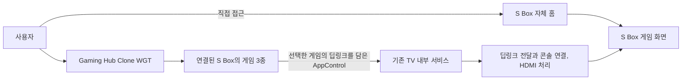

# Gaming Hub Clone WGT 요구사항

2026-10-27 추가 요구사항. TV에 설치하는 별도 **Gaming Hub Clone WGT 한 개**를 만든다. 이 앱은 S Box에 연결된 게임을 카드로 보여 주는 TV 런처이며, 게임을 선택하면 딥링크 정보를 담은 AppControl로 기존 내부 서비스를 호출한다. 내부 서비스와 그 이후의 딥링크 처리, 콘솔 연결과 HDMI 동작은 다른 구현 담당자가 맡는다.

현재는 요구사항만 반영한 상태다. Hub 화면과 WGT 빌드, AppControl 송신은 아직 구현하지 않았으며 서비스 연동과 실기기 동작도 검증하지 않았다.

## 제품과 연결 관계

- S Box는 기존처럼 자체 홈에 직접 접근해 게임을 선택할 수 있다.
- Gaming Hub는 연결된 S Box의 게임으로 진입하는 별도 경로다. Hub 자체가 S Box 콘솔이 되거나 게임을 실행하지 않는다.
- 실제 제품 개념에서는 연결 가능한 콘솔이 S Box이며, 런처에는 그 S Box에 연결된 개별 게임의 아이콘과 카드가 들어간다. 이번 데모에는 기존 세 게임을 노출한다.
- 기존 게임별 WGT 세 개에 더해 Hub WGT 한 개를 추가한다. 기존 WGT의 식별자와 HTTP/App Control 동작은 유지한다.

Hub가 담당하는 범위는 위 흐름의 게임 목록, 선택과 AppControl 송신까지다. 내부 서비스가 요청을 받은 뒤 사용하는 통신 경로와 실제 게임 화면 전환은 서비스 담당자의 구현 범위다.

## 화면

사용자가 제공한 화면을 배치와 분위기의 기준으로 삼는다. 어두운 남색과 보라색 배경, 상단의 작은 탐색 아이콘, 넓은 게임 배너, 아래의 가로 게임 카드와 하단의 연결 서비스 아이콘 구성을 따른다. 배너와 카드의 실제 콘텐츠는 기존 S Box 게임 자산을 재사용한다.

| 영역 | 요구사항 |
|---|---|
| 상단 | Gaming Hub Clone 식별과 간결한 아이콘 탐색 영역. 제공하지 않는 검색, 계정, 스토어 기능을 작동하는 것처럼 표시하지 않음 |
| 메인 배너 | 선택한 게임의 큰 배경 이미지와 이름을 표시. 포커스를 옮기면 해당 게임으로 갱신 |
| 게임 런처 | 기존 세 게임을 같은 줄에 표시. 각 게임의 이미지, 아이콘과 이름을 구분하고 TV 화면에서 세 항목을 함께 탐색 가능 |
| 하단 | S Box 아이콘으로 연결된 콘솔의 맥락을 표시. 다른 클라우드 게임 사업자의 연동은 이번 범위에 포함하지 않음 |
| 실행 상태 | 호출 중, 호출 접수 또는 호출 오류를 필요한 시점에 짧게 표시 |

TV 가로 16:9 화면을 기본으로 하고 1920×1080과 1280×720에서 카드와 포커스가 잘리지 않게 구성한다. 현재 선택은 색뿐 아니라 테두리와 크기 변화 등으로 구분한다. 사용자 지정 TV 화면 구성을 우선하고 보조 버튼과 설명은 작게 유지한다.

### 게임과 식별자

| 순서 | 게임 | 기존 게임 application ID | 재사용 자산 |
|---|---|---|---|
| 1 | Apex Racing | `R7kP2mN9vQ.ApexRacing` | `assets/games/apex-racing/` |
| 2 | Forest Quest | `F3bT8xL4cW.ForestQuest` | `assets/games/forest-quest/` |
| 3 | Orbit Arena | `O6nH1sD5aZ.OrbitArena` | `assets/games/orbit-arena/` |

위 ID는 선택한 게임을 식별하는 기존 값이다. 새 Hub WGT 자체의 application ID나 AppControl을 받을 서비스의 ID와 혼동하지 않는다. Hub의 설치 아이콘과 package/application ID는 기존 세 게임과 구분해 지정한다.

## 입력과 실행 동작

1. Hub를 열면 세 게임을 표시하고 첫 게임에 포커스를 둔다. Hub 진입이나 포커스 이동만으로 AppControl을 호출하지 않는다.
2. 리모컨 방향키로 게임을 선택하고 확인 키로 실행한다. PC 확인용으로 방향키와 Enter, 마우스 클릭도 지원한다.
3. 실행 입력 한 번에 선택한 게임의 AppControl 한 건을 보낸다. 콜백 대기 중에는 연속 확인 입력으로 중복 실행하지 않는다.
4. 호출 오류나 응답 시간 초과를 표시하고 다시 선택하거나 재시도할 수 있게 한다. 자동 재전송으로 게임이 중복 실행되지 않게 한다.
5. Back/Return은 열려 있는 안내를 먼저 닫고, Hub 기본 화면에서는 앱을 나가는 동작으로 처리한다. 취소와 오류 뒤에는 선택한 게임을 유지한다.

AppControl 호출 접수와 실제 게임 실행 완료는 구분한다. Hub에서 임의로 S Box 타이틀 화면을 표시해 연동 성공을 대신하지 않는다. 호출 성공 뒤 Hub 자체 종료 여부와 재진입 때의 선택 복원은 서비스의 포그라운드 전환 방식에 맞춰 연동 시 확정한다.

## AppControl 송신과 서비스 인계

기존 게임 WGT는 PC B에 게임 ID를 HTTP로 보내고, 별도로 내부 서비스에 데이터 없는 HDMI 활성화 요청을 보낸다. 새 Hub에서는 **선택한 게임의 딥링크를 AppControl로 내부 서비스에 전달**한다. Hub가 기존 게임 WGT를 중간에 실행하거나 PC B에 같은 요청을 별도로 보내는 흐름은 추가하지 않는다.

| 항목 | 요구사항과 확정 상태 |
|---|---|
| 호출 대상 | 기존 TV 내부 서비스. 현재 프로젝트의 대상 ID는 `com.hssg.tvservice`이며 Hub 수신 진입점과 함께 서비스 담당자가 확인 |
| 선택 정보 | 세 게임 중 무엇을 선택했는지 서비스가 구분할 수 있는 딥링크 정보 필수 |
| 게임 매핑 | 위 게임 application ID와 딥링크의 대응을 명시. 문자열을 Hub와 서비스가 각각 다르게 추정하지 않음 |
| operation | Hub 딥링크용 값을 서비스 담당자와 확정. 기존 `activate_hdmi`가 게임 딥링크도 받는다고 가정하지 않음 |
| URI와 data | 딥링크를 URI로 보낼지, 어떤 data 키로 보낼지 서비스 담당자와 확정. 실제 값이 정해지면 이 문서와 송신 설정에 함께 기록 |
| 호출자 허용 | Hub의 새 application ID를 서비스에서 허용. 기존 세 게임만 허용하는 v1 목록에 자동 포함된 것으로 보지 않음 |
| 응답과 수명 | 호출 실패, 콜백 제한 시간과 Hub 종료 정책을 연동 시 확정. HDMI나 게임 완료 reply를 기다릴 필요가 있는지도 구분 |

**게임마다 호출자 ID가 달랐던 기존 방식과 달리 Hub의 호출자 ID는 하나다.** 따라서 기존의 `data: []`, `uri: null`과 호출자 ID만으로 세 게임을 구분할 수 없다. 서비스 담당자에게 게임 식별이 가능한 새 딥링크 계약이 필요하다는 점을 전달한다. 기존 [TV 서비스 v1 명세](tv-service.md)의 빈 데이터 계약은 기존 세 게임 WGT에 적용한다.

계약이 확정되지 않은 상태에서는 모의 AppControl 수신부로 게임별 호출값을 확인한다. 실서비스를 임의의 operation이나 URI로 호출하지 않으며, 계약 부재를 사용자 화면의 설정 작업으로 떠넘기지 않는다.

서비스 담당자에게 인계할 항목은 다음과 같다.

1. Hub application ID와 수신 허용 조건.
2. 대상 서비스 ID, operation, URI/data 형식과 세 게임의 정확한 매핑.
3. 호출 성공과 실패의 의미, 시간 제한과 Hub 종료/복귀 정책.
4. 서비스 이후의 딥링크 전달, S Box 대상 결정과 HDMI 처리. 이번 Hub 구현 범위와 별도.

## 패키지와 산출물

Hub는 기존 세 게임 WGT와 별도 설치되는 WGT 한 개로 빌드한다. 예정 산출물은 `dist/unsigned/gaming-hub.wgt`이며 현재 생성된 파일은 아니다. UI와 필요한 게임 이미지, 아이콘을 패키지에 포함한다. 기존 게임 WGT도 계속 빌드할 수 있어야 한다.

개인 설정과 서명키를 패키지나 Git에 넣지 않는다. 서명 전 패키지 생성, 인증서 서명, TV 설치와 실제 서비스 호출은 각각 확인한다. 브라우저나 모의 Tizen API로 확인한 송신을 TV 연동 완료로 보고하지 않는다.

## 수용 조건과 진행 상태

| 항목 | 확인 기준 | 현재 상태 |
|---|---|---|
| 화면 | 첨부를 따른 배너와 카드 구성, 기존 세 게임의 이름과 자산, S Box 연결 맥락 표시 | 요구사항 반영, 구현 전 |
| 조작 | 리모컨 방향키/확인/Back, 키보드와 클릭으로 탐색과 실행 가능 | 요구사항 반영, 구현 전 |
| 송신 | 각 게임 선택 시 대응 딥링크의 AppControl 한 건. 포커스 이동과 연속 입력으로 중복 호출하지 않음 | 서비스 계약 확정 및 구현 전 |
| 오류 | 서비스 미설치, 호출 거부와 시간 초과 뒤 오류 표시, 선택 유지와 재시도 가능 | 구현 및 검증 전 |
| 패키지 | 고유 Hub ID와 설치 아이콘을 가진 별도 WGT 한 개, 필요한 자산 포함 | 빌드 전 |
| 기존 기능 | S Box 직접 접근과 기존 세 게임 WGT의 실행 흐름 유지 | 이번 변경은 문서에 한정, 코드 변경 없음 |
| TV 연동 | 서명한 Hub에서 실제 서비스의 수신과 선택 게임 매핑 확인 | 실기기 검증 전 |
| 하위 처리 | 서비스 이후 S Box 딥링크, 게임 전환과 HDMI 동작 | 다른 담당자의 구현 및 검증 범위 |

[기존 전체 흐름](flow.md) | [S Box 콘솔](console.md) | [TV 서비스 v1 명세](tv-service.md) | [문서 안내](README.md)
