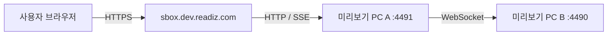

# S Box 개발 미리보기

화면 확인 주소는 **<https://sbox.dev.readiz.com>**이다. `localhost`는 개발자가 내부 상태를 확인할 때 사용하며, 사용자에게 전달하는 미리보기 주소는 `*.dev.readiz.com`을 사용한다.

페이지를 열면 S Box 부팅 화면이 나오고 방향키·Enter·Esc로 세 게임의 로딩과 타이틀 화면을 확인할 수 있다. 이 주소의 브라우저들은 하나의 미리보기 콘솔 상태를 공유하므로 한 사람이 게임을 바꾸면 다른 접속자의 화면도 바뀐다.

## 실행 구조

`npm run preview`는 A/B를 각각 `127.0.0.1:4491`, `127.0.0.1:4490`에 띄운다. 공개 주소는 Caddy가 A에 연결하며, B는 외부에 공개하지 않는다. 별도 포트가 필요하면 `SBOX_CONSOLE_PORT`, `SBOX_RELAY_PORT`를 지정하고 프록시의 대상 포트도 맞춘다.

이 실행 모드는 로컬 설정을 읽거나 WGT를 재생성하지 않는다. Windows/HDMI 데모의 기본 포트 `4100`/`4101`, B IP 입력, WGT 생성과 설치 흐름은 [실행 가이드](setup.md)를 따른다.

## 배포와 확인

- `ops/caddy/preview.Caddyfile`이 개발 호스트의 HTTP→HTTPS 전환, 역방향 프록시, 검색 제외 헤더와 `/robots.txt`를 정의한다.
- 검증한 소스와 의존성을 전용 실행 디렉터리에 배치하고, 개발 서버 호스트의 프로세스 관리자로 `scripts/preview-server.mjs`를 유지한다. 채팅 터미널의 수명에 의존하지 않는다.
- Caddy의 기존 설정을 백업하고 이 호스트 설정만 추가한다. 전체 설정을 검증한 뒤 reload하며, 기존 서비스의 라우트와 DNS 레코드는 유지한다.
- 배포 후 일반 DNS의 HTTPS와 인증서, 핵심 JS/CSS/이미지, SSE 이벤트 전달, 키보드로 게임 실행과 홈 복귀를 확인한다.
- 실행 경로·포트·프로세스 이름·로그·중지 방법은 배포 호스트의 비공개 관리 기록에 보관한다. 개인 경로와 서버 설정 백업은 공개 저장소에 넣지 않는다.

이 미리보기는 공개된 가상 게임 UI 데모다. TV WGT 설치, C# 내부 서비스와 HDMI/CEC 실기기 동작은 이 주소로 검증하지 않는다.

[문서 안내](README.md) | [S Box 화면과 조작](console.md)
