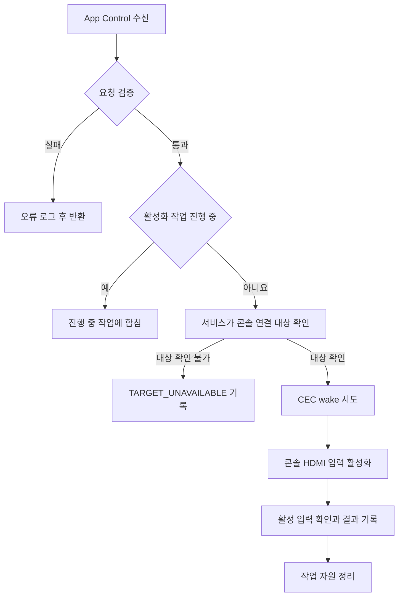

# com.hssg.tvservice C# 앱 구현 명세

이 문서는 TV 내부 앱 `com.hssg.tvservice`의 구현 담당자에게 전달하는 v1 연동 규격이다. 게임 WGT에서 App Control을 받으면 연결된 콘솔을 CEC로 깨우는 동작을 시도하고, TV가 그 콘솔의 HDMI 화면을 표시하도록 한다.

**WGT는 HDMI 포트 번호나 게임 정보를 보내지 않는다. 호출 대상과 operation만 지정한다.** 활성화할 콘솔 연결은 내부 서비스가 처리한다. 앱 ID는 사용자 지정값이며, 아래 operation은 이 프로젝트에서 정한 연동 식별자다. 기존 Samsung 내부 API 이름을 뜻하지 않는다.

## 1. 역할과 실행 환경

```text
TV 게임 WGT ──HTTP──> PC B ──WebSocket──> 연결된 모든 PC A의 앱 전환
      │
      └──App Control──> com.hssg.tvservice (C#)
                             ├──연결된 콘솔의 CEC wake 시도
                             └──그 콘솔의 HDMI 화면 활성화
```

PC A들이 PC B에 먼저 WebSocket으로 연결한다. PC B는 게임 ID를 받은 시점에 연결된 모든 A에 앱 전환 명령을 보낸다. 향후 리모컨 역할의 PC C도 동일한 PC B HTTP 인터페이스를 사용한다.

C# 내부 앱은 TV의 HDMI 처리를 담당한다. PC A/B 주소를 알 필요가 없고, HTTP 요청이나 게임 실행 명령을 중복 수행하지 않는다.

| 항목 | 요구사항 |
|---|---|
| 실행 위치 | 대상 Tizen TV |
| 언어와 런타임 | C#, 대상 TV가 지원하는 Tizen .NET SDK |
| 설치된 application ID | `com.hssg.tvservice`와 정확히 일치 |
| 패키지 | C# 앱의 TPK 또는 해당 내부 앱 배포 형식. 호출자 3개는 WGT |
| 수신 진입점 | `OnAppControlReceived(AppControlReceivedEventArgs e)` |
| 화면 | 별도 조작 UI 없이 처리. HDMI 화면 위에 앱 창이나 로딩 화면을 남기지 않음 |
| TV 상태 | TV가 켜져 있고 WGT 실행이 가능한 상태. TV 자체를 꺼진 상태에서 켜는 요청은 아님 |
| 데모 PC | PC A와 브라우저를 미리 켜 둠. PC의 CEC 전원 제어 지원은 전제하지 않음 |

### 배포 전제

세 WGT와 C# 앱은 서로 다른 패키지다. **일반 `.NET ServiceApplication`을 별도 패키지로 만들었다는 이유만으로 외부 WGT의 호출이 허용되지는 않는다.** Tizen의 일반 서비스 앱에는 패키지 밖 App Control 실행 제한이 있고, 백그라운드 실행 정책도 적용된다. [App Control 제한](https://docs.tizen.org/application/native/guides/app-management/app-controls/), [공식 .NET 서비스 앱 가이드](https://github.com/Samsung/tizen-docs/blob/master/docs/application/dotnet/guides/applications/service-application.md)

대상 TV 플랫폼에서 `com.hssg.tvservice`를 외부 WGT가 명시적으로 호출할 수 있는 내부 C# 진입점으로 제공해야 한다. 기존 내부 C# 앱에 수신부를 붙이면 그 앱의 승인된 실행 형태를 사용한다. 새 앱이면 플랫폼 담당자가 앱 유형, 외부 호출 정책, 서명과 HDMI 권한을 확정한다. 일반 ServiceApplication 구성이 거부되면 동일 application ID의 허용된 C# 진입점 구성을 확정해야 한다.

구현 담당자가 확보할 기기별 정보:

1. TV 모델과 펌웨어, 사용 가능한 .NET SDK 버전
2. 외부 WGT에서 이 앱을 호출하도록 허용하는 배포 설정
3. 내부 서비스가 사용하는 콘솔 연결 대상과 이를 활성화하는 플랫폼 API
4. CEC wake 및 입력 활성화 API의 권한, 서명, 스레드 제약
5. WGT 종료 후에도 내부 앱의 처리가 계속되는 실행 정책

실제 하드웨어 SDK 함수명과 권한 문자열은 공개 자료만으로 확정하지 않았다. 임의의 `Tizen.Hdmi` API를 가정하지 않는다. 아래 수신부와 처리 규격을 구현하고, 하드웨어 호출부를 대상 TV의 실제 내부 API에 연결한다.

## 2. App Control 요청 규격

| 필드 | 정확한 값 |
|---|---|
| 대상 application ID | `com.hssg.tvservice` |
| operation | `http://hssg.com/appcontrol/operation/activate_hdmi` |
| URI, MIME, category | 모두 `null` |
| data | 빈 배열 `[]` |
| launchMode | `SINGLE` |
| 서비스 결과 reply | v1 WGT는 요청하지 않음 |

operation은 비교용 식별자다. 이 주소에 HTTP 접속하지 않는다. 대소문자와 경로는 정확히 일치시킨다. HDMI 포트, 게임 ID, PC 주소, 사용자 정보, request ID를 추가하지 않는다.

### 호출자와 검증

게임 ID를 본문에서 읽지 않고, 플랫폼이 제공하는 `ReceivedAppControl.CallerApplicationId`를 확인한다.

| 호출자 | application ID |
|---|---|
| A게임 WGT | `R7kP2mN9vQ.ApexRacing` |
| B게임 WGT | `F3bT8xL4cW.ForestQuest` |
| C게임 WGT | `O6nH1sD5aZ.OrbitArena` |

세 앱은 모두 동일한 HDMI 활성화 동작을 요청한다. 호출자 ID가 비어 있거나 목록에 없으면 `CALLER_NOT_ALLOWED`, operation이 다르면 `UNSUPPORTED_OPERATION`으로 거부한다. URI, MIME, category는 `null` 또는 SDK가 반환한 빈 문자열만 허용한다. extra data는 읽거나 동작 분기에 사용하지 않는다. 배포 정책이 요구하는 서명 검증은 별도로 적용한다.

검증 실패 시 CEC와 HDMI API를 호출하지 않는다. 홈 화면에서 직접 C# 앱을 실행해 operation이나 호출자 정보가 없는 경우도 HDMI를 임의로 바꾸지 않는다.

## 3. WGT 송신 예제

```javascript
var control = new tizen.ApplicationControl(
  'http://hssg.com/appcontrol/operation/activate_hdmi',
  null, null, null, [], 'SINGLE'
);
tizen.application.launchAppControl(
  control,
  'com.hssg.tvservice',
  function () { console.log('App Control dispatched'); },
  function (error) { console.error(error.name + ': ' + error.message); }
);
```

이는 `tv/hdmi.js`의 호출과 같다. 성공 콜백은 플랫폼의 호출 결과이며 HDMI 처리 완료가 아니다. `SINGLE`은 호출자와 분리된 실행을 요청한다. [Samsung Web Application API](https://developer.samsung.com/smarttv/develop/api-references/tizen-web-device-api-references/application-api.html)

WGT는 HTTP와 App Control을 각각 시작하고, 양쪽 성공/실패 콜백이 끝나면 자체 종료한다. 콜백 누락 시 7초 타이머로 종료를 시도한다. C# 앱은 이미 WGT가 종료된 상태에서도 HDMI 작업을 마쳐야 한다. 호출자가 종료될 때 함께 종료되는 실행 그룹 구성을 사용하지 않는다. [Tizen .NET App Control의 실행 그룹](https://github.com/Samsung/tizen-docs/blob/master/docs/application/dotnet/guides/exchange-data-between-apps/app-controls.md)

## 4. HDMI 처리 순서



1. 수신 콜백에서 요청을 검증하고 호출자 문자열을 복사한다. 비동기 작업에 `ReceivedAppControl` 객체를 그대로 넘기지 않는다.
2. 작업을 등록하고 콜백을 빠르게 반환한다. `.Wait()`, `.Result`, `Thread.Sleep()`로 메인 스레드를 막지 않는다.
3. 내부 서비스가 관리하는 콘솔 연결 대상을 확인한다. 호출자가 HDMI를 지정하거나 선택 UI에 답할 필요가 없어야 한다. 대상이 없거나 하나로 결정되지 않으면 `TARGET_UNAVAILABLE`로 끝내며 임의의 입력을 선택하지 않는다.
4. 그 대상에 CEC wake를 시도한다. 전원을 켜는 의미의 명령만 사용하고 전원 토글이나 standby 명령은 보내지 않는다.
5. CEC 결과와 관계없이 콘솔 HDMI 입력 활성화를 시도한다. PC나 CEC 비지원 장치, CEC 비활성 상태에서도 입력 활성화가 진행되어야 한다.
6. 활성 입력이 서비스가 선택한 콘솔 연결과 일치하는지 확인한다. 이미 활성화되어 있으면 불필요한 재전환을 생략한다. 완료 후 원래 TV 입력으로 되돌리지 않는다.
7. 로그를 남기고 이벤트 구독, 타이머, 임시 자원을 정리한다. 다음 호출도 받을 수 있어야 한다.

### 시간 제한과 연속 호출

다음은 데모에서 정한 처리 한도이며 플랫폼 보장 수치가 아니다.

| 항목 | 처리 규칙 |
|---|---|
| CEC wake | 최대 2초. 미응답 시 경고를 남기고 입력 활성화로 진행 |
| 입력 활성화와 상태 확인 | 최대 3초. 확인되지 않으면 `INPUT_SWITCH_TIMEOUT` |
| 전체 처리 | 수신 후 5초 내 최종 상태 기록 목표. 콜드 스타트 지연은 별도 측정 |
| 처리 중 새 요청 | 모두 같은 의미이므로 진행 중 작업에 합침. 추가 CEC/입력 작업 없음 |
| 처리 완료 후 새 요청 | 다시 검증하고 실행. 이미 활성화된 입력의 재전환은 생략 |
| 자동 재시도와 대기열 | 없음 |

취소 불가능한 내부 작업이 계속 실행 중이면 잠금을 유지해 후속 작업과 겹치지 않게 한다. 늦게 도착한 콜백이 다음 작업 결과를 덮어쓰지 않도록 내부 작업 식별값을 관리한다. 이 식별값은 서비스 내부용이며 WGT에 전달을 요구하지 않는다.

입력 선택과 영상 신호 감지는 구분한다. 케이블 분리 시 입력을 선택해도 신호 없음이 표시될 수 있다. PC A의 게임 렌더링 완료를 서비스가 추정하지 않는다.

## 5. C# 수신부 예제

대상 TV용으로 생성한 C# 앱 클래스에 넣을 메서드와 필드다. `HdmiCoordinator`는 다음 절에 정의한 프로젝트 내부 클래스이며 직접 구현한다. 이 코드는 수신부 예제이고 전체 TPK 프로젝트나 하드웨어 드라이버가 아니다.

```csharp
using System;
using System.Collections.Generic;
using Tizen.Applications;

// Fields and methods inside the existing Tizen application class.
private const string ActivateHdmi =
    "http://hssg.com/appcontrol/operation/activate_hdmi";
private static readonly HashSet<string> AllowedCallers = new HashSet<string>
{
    "R7kP2mN9vQ.ApexRacing",
    "F3bT8xL4cW.ForestQuest",
    "O6nH1sD5aZ.OrbitArena"
};
// Initialize in OnCreate with the real platform adapter and logger.
private HdmiCoordinator coordinator;

protected override void OnAppControlReceived(AppControlReceivedEventArgs e)
{
    base.OnAppControlReceived(e);
    if (coordinator == null)
    {
        Tizen.Log.Error("TVSERVICE", "INTERNAL_ERROR: not initialized");
        return;
    }
    try
    {
        var control = e.ReceivedAppControl;
        var caller = control.CallerApplicationId;
        if (!AllowedCallers.Contains(caller ?? ""))
        {
            coordinator.Reject("CALLER_NOT_ALLOWED", caller);
            return;
        }
        if (control.Operation != ActivateHdmi)
        {
            coordinator.Reject("UNSUPPORTED_OPERATION", caller);
            return;
        }
        if (!string.IsNullOrEmpty(control.Uri) ||
            !string.IsNullOrEmpty(control.Mime) ||
            !string.IsNullOrEmpty(control.Category))
        {
            coordinator.Reject("INVALID_REQUEST", caller);
            return;
        }
        // No HDMI port or game data is read from ExtraData.
        coordinator.Accept(caller); // Nonblocking, coalesces active work.
    }
    catch (Exception error)
    {
        coordinator.Reject("INTERNAL_ERROR", null, error.GetType().Name);
    }
}
```

수신 이벤트와 `CallerApplicationId`는 공식 API를 따른다. 참조 assembly와 기반 클래스는 대상 TV SDK에 맞춘다. [ReceivedAppControl 공식 구현](https://github.com/Samsung/TizenFX/blob/main/src/Tizen.Applications.Common/Tizen.Applications/ReceivedAppControl.cs)

### 앱 설정과 수명주기

- 설치된 application ID를 `com.hssg.tvservice`로 맞춘다. package ID나 DLL 이름과 혼동하지 않는다.
- App Control 선언에 정확한 operation을 등록한다. URI와 MIME 필터는 사용하지 않는다.
- 단일 인스턴스로 실행하되 이미 실행 중인 앱도 새 요청을 처리한다.
- UI를 표시하지 않고 WGT 종료 이후 처리도 유지한다.
- 기존 상주 내부 앱이면 작업 자원만 해제한다. 일회성 앱이면 작업 정리 후 종료할 수 있지만 HDMI 상태 유지와 후속 호출의 재기동을 확인한다.
- `OnTerminate`에서 작업을 취소하고 자원을 해제한다. 다음 시작 때 미완료 명령을 자동 재생하지 않는다.

아래 선언을 프로젝트의 승인된 `ui-application` 또는 `service-application` 요소 안에 넣는다. 이것만으로 내부 HDMI 권한이나 외부 서비스 호출 제한이 해결되지는 않는다.

```xml
<app-control>
  <operation name="http://hssg.com/appcontrol/operation/activate_hdmi" />
</app-control>
```

WGT의 `application.launch`와 C# 송신용 `appmanager.launch` 권한은 구분한다. 수신 앱에 송신용 권한을 무조건 추가하지 않는다. HDMI/CEC 권한은 사용할 내부 API 명세에 따라 선언한다.

## 6. 내부 클래스와 플랫폼 연결부

| 구성 | 구현 계약 |
|---|---|
| `HdmiCoordinator.Accept(string caller)` | 진행 중이면 병합 로그 후 반환. 아니면 작업 등록 후 비동기 실행. 호출자에게 즉시 반환 |
| `Reject(string code, string caller, string detail = null)` | 하드웨어 호출 없이 오류 로그 한 줄 기록 |
| 작업 실행부 | 콘솔 연결 대상 확인 → CEC wake → 입력 활성화 → 결과 기록. 모든 예외를 잡고 자원 정리 |
| 플랫폼 연결부 | 서비스가 아는 콘솔 대상을 사용. WGT에서 대상 선택 데이터를 요구하지 않음 |

다음 두 동작 이름은 이 문서의 추상 인터페이스이며 Tizen SDK 함수명이 아니다.

| 동작 | 결과 | 연결할 플랫폼 기능 |
|---|---|---|
| `TryWakeConsole` | `sent`, `already_on`, `unsupported`, `disabled`, `timeout`, `failed` | 콘솔 연결 대상으로 CEC wake. `sent`는 전원 켜짐 확인을 뜻하지 않음 |
| `ActivateConsoleInput` | `confirmed`, `already_selected`, `timeout`, `failed` | 동일 대상의 입력 활성화와 실제 활성 입력 확인 |

대상 해석은 작업당 한 번 수행하고 두 동작이 같은 대상을 사용한다. 처리 중 케이블이나 등록 정보가 바뀌어 대상을 확인할 수 없으면 실패로 기록한다. 전원 상태 조회가 없으면 `already_on`으로 추정하지 않는다. 입력 확인 API가 없다면 전환 요청 접수만으로 `confirmed`를 반환하지 않는다.

API가 특정 스레드를 요구하면 해당 스레드에서 호출한다. 임의의 `Task.Run`으로 제약을 우회하지 않는다. 이벤트 구독/해제와 취소까지 플랫폼 연결부에 포함한다.

## 7. 응답과 로그

WGT는 서비스 reply 콜백을 등록하지 않는다. 내부 앱의 완료 응답을 받아야 WGT가 종료되는 구조가 아니며, 결과 채널은 서비스 로그다. WGT에 응답 대기, 재실행, 강제 종료를 요구하지 않는다. 추후 결과 reply가 필요하면 호출자와 수신자 규격을 함께 변경한다.

| 코드/상태 | 처리 |
|---|---|
| `CALLER_NOT_ALLOWED`, `UNSUPPORTED_OPERATION`, `INVALID_REQUEST` | 검증 실패, 하드웨어 미호출 |
| `TARGET_UNAVAILABLE` | 내부에서 콘솔 연결 대상을 확인하지 못함, 임의 입력 선택 없음 |
| CEC `unsupported`, `disabled`, `timeout`, `failed` | 경고 기록 후 입력 활성화 계속 |
| `INPUT_SWITCH_FAILED`, `INPUT_SWITCH_TIMEOUT` | 실패 기록. 자동 재시도나 원래 입력 복구 없음 |
| `COMPLETED` | 입력 확인 성공. CEC 결과는 별도로 기록 |
| `INTERNAL_ERROR` | 예외 종류 기록, 자원 정리, 다음 요청 수신 가능 상태로 복구 |

수신, 거부, 병합, CEC 결과, 입력 결과, 완료를 로그로 구분한다. 시각, 앱 버전, 내부 작업 번호, 호출자 ID, 단계, 결과, 경과 시간(ms)을 기록한다. 내부 대상 식별자는 진단에 필요한 범위에서 내부 로그에만 남긴다.

```text
TVSERVICE task=12 caller=R7kP2mN9vQ.ApexRacing stage=received elapsed_ms=0
TVSERVICE task=12 stage=cec result=unsupported elapsed_ms=15
TVSERVICE task=12 stage=input result=confirmed elapsed_ms=310
TVSERVICE task=12 stage=finished code=COMPLETED wake=unsupported elapsed_ms=311
```

이 예시는 입력 활성화 성공이고 CEC 전원 켜짐은 확인하지 않은 결과다.

## 8. 빌드와 전달물

1. 대상 TV에 맞는 .NET 프로젝트, application ID와 승인된 실행 형태를 준비한다.
2. 수신부, coordinator, 실제 플랫폼 연결부를 구현한다.
3. 내부 API 권한과 서명을 적용하고 패키지를 TV에 설치한다.
4. PC B를 실행하고 PC A들이 B에 연결된 상태에서 각 콘솔 브라우저를 연다.
5. WGT 빌드 PC에 PC B 주소를 설정하고 WGT를 빌드, 서명, 설치한다.
6. 다음 인수 테스트의 로그와 화면 결과를 기록한다.

WGT 설정은 다음과 같다. `config.local.json`은 WGT 빌드 PC용이며 C# 앱이 읽는 파일이 아니다.

```json
{
  "pcBUrl": "http://192.168.0.20:4100",
  "hdmi": {
    "appId": "com.hssg.tvservice",
    "operation": "http://hssg.com/appcontrol/operation/activate_hdmi",
    "uri": null,
    "data": []
  }
}
```

서비스 담당자는 프로젝트와 설치 패키지, 대상 모델/펌웨어와 SDK 버전, 실제 API 연결 설명, 테스트 결과와 로그를 전달한다. 내부 API 소스나 서명 자료의 공개 범위는 별도로 정한다.

## 9. 인수 테스트

| 번호 | 조건 | 기대 결과 |
|---|---|---|
| 1 | 내부 앱 종료 상태에서 A WGT 실행 | 앱 시작과 요청 수신, 콘솔 HDMI 표시, 연결된 PC A들은 A게임으로 전환 |
| 2 | 내부 앱 실행 중 B/C WGT 실행 | 매 요청 수신, 모든 PC A의 앱 전환, 내부 서비스는 동일한 HDMI 활성화 수행 |
| 3 | 실제 App Control 데이터 확인 | 빈 배열. HDMI 포트/게임 ID/PC 주소 없음 |
| 4 | WGT가 호출 콜백 직후 종료 | 서비스 작업 계속, HDMI 상태 유지, WGT 재실행 없음 |
| 5 | PC A를 켜 둔 채 CEC 비지원/비활성 상태 | 경고와 별개로 HDMI 입력 활성화 |
| 6 | CEC 지원 콘솔이 대기 상태 | wake 시도와 실제 전원 켜짐을 각각 확인. PC 데모와 별도 판정 |
| 7 | 이미 콘솔 HDMI 표시 중 | 불필요한 입력 토글이나 재전환 없음 |
| 8 | A/B/C WGT 요청 연속 수신 | 처리 중 하드웨어 작업 하나, 추가 요청 병합 |
| 9 | 콘솔 연결 대상을 결정하지 못함 | TARGET_UNAVAILABLE, 임의의 입력으로 이동하지 않음 |
| 10 | 다른 operation/미허용 호출자 | 거부, 기존 TV 입력 유지 |
| 11 | PC B 연결 끊김/일부 A 실패 | HTTP 결과와 별개로 TV의 HDMI 요청 처리 |
| 12 | 내부 앱 미설치/호출 권한 차단 | WGT App Control 오류, HTTP 경로는 독립 실행, 종료 흐름 유지 |
| 13 | CEC 콜백 누락 | 2초 제한 후 입력 활성화 진행, UI 스레드 멈춤 없음 |
| 14 | 입력 활성화 실패/시간 초과 | 명확한 오류 로그, 늦은 콜백이 다음 작업을 덮어쓰지 않음 |
| 15 | 케이블 분리/영상 신호 없음 | 입력 활성화와 영상 신호 결과 구분, 게임 준비 완료를 추정하지 않음 |
| 16 | 작업 중 내부 앱 종료 후 재호출 | 자원 누수나 이전 요청 재생 없이 새 작업 수행 |

완료 판정은 App Control 수신, 콘솔 HDMI 입력 활성화, WGT 종료 후 처리 유지, PC A 게임 화면을 실기기에서 확인하는 것이다. CEC 전원 wake는 CEC 지원 기기로 따로 검증한다.

이 저장소는 WGT 송신부와 모의 테스트를 제공한다. C# 앱 빌드, 내부 API 연결, TV 설치와 실기기 검증은 이 문서의 구현 담당 범위다.

[전체 흐름도](flow.md) | [실행 가이드](setup.md) | [문서 안내](README.md)
